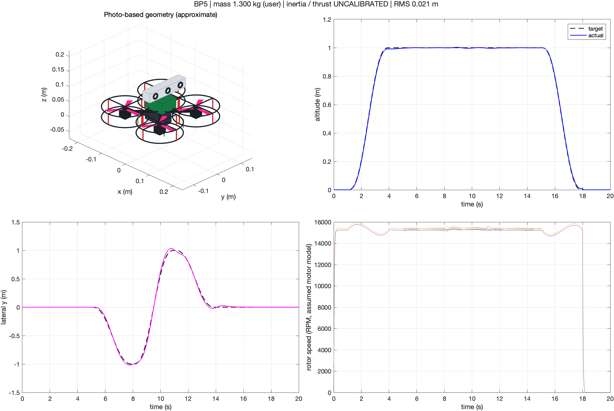

# BP5 MATLAB 비행 시뮬레이션

사진을 참고한 BP5 외형과 사용자 제공 총질량 **1.3kg**을 반영한 초기 모델입니다. MATLAB R2024b Update 5에서 비행·착륙·모터 정지와 물리 계산을 검증했습니다.

MATLAB 현재 폴더를 이 폴더로 선택한 후 실행합니다.

```matlab
L = run_bp5_demo;
```

- [한국어 설명서: 파라미터, 측정 방법, 제어 모델, 강화학습 환경](README_KO.md)
- [전체 파일 압축본](BP5_MATLAB_1300g.zip)
- [20초 비행 미리보기 영상](results/flight.mp4)
- [검증 기록](results/verification.json)

관성·추력·부품별 질량분포는 추정값입니다. 기본 데모는 MATLAB만 필요하며, 강화학습 연결 어댑터에는 Reinforcement Learning Toolbox가 필요합니다. 학습된 에이전트와 Simscape 모델은 아직 포함하지 않습니다.


