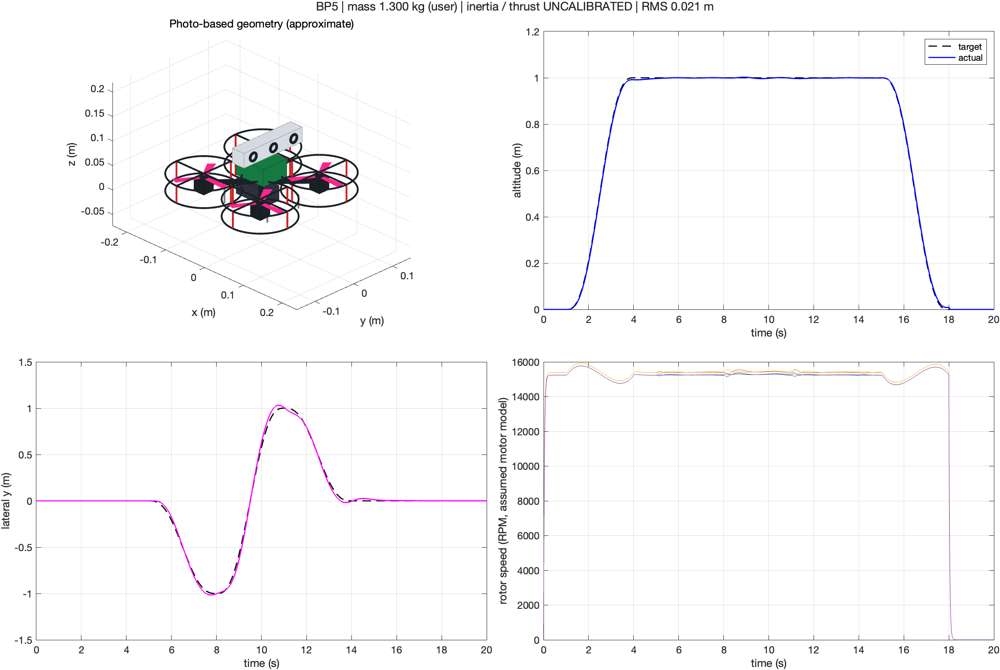

# Drone

드론 모델링·비행 제어·강화학습 실험을 정리하는 저장소입니다.

## BP5 MATLAB

[BP5_MATLAB](BP5_MATLAB/)에는 BP5 프레임과 실제 조립 사진을 참고한 MATLAB 비행 시뮬레이션이 있습니다. 사용자 제공 비행 상태 총질량 **1.3kg**을 반영했습니다.

- 3D 기체 외형과 이륙·좌우 이동·착륙 애니메이션
- 위치·자세 제어, 모터 응답, 위치 추종 그래프
- 강화학습용 호버링 환경 코드
- [한국어 설명서](BP5_MATLAB/README_KO.md)

기본 데모는 MATLAB만으로 실행됩니다. 관성·추력·질량분포는 아직 추정값이며, 학습된 강화학습 에이전트는 포함하지 않습니다.

